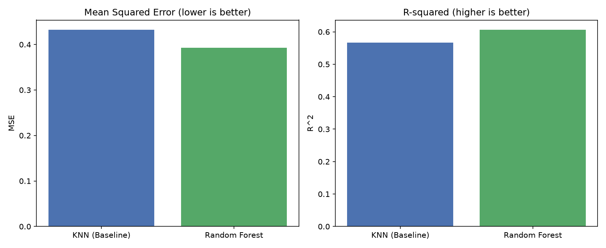
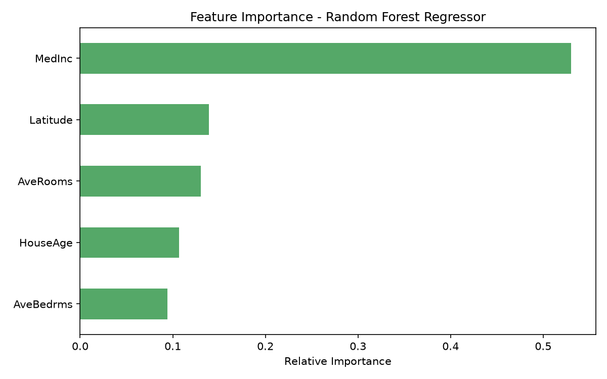
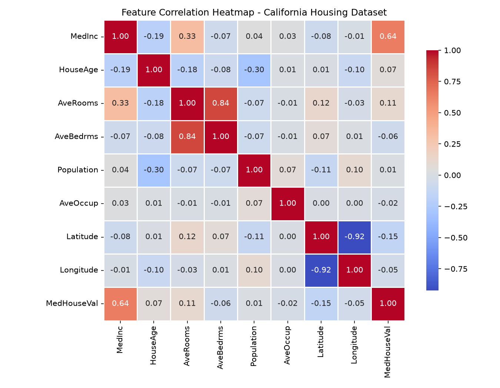

# California Housing — Regression Study

A reproducible regression benchmark comparing a tuned **k-Nearest Neighbours** baseline against a **Random Forest** regressor for median house-value prediction, using the 20,640-record California Housing dataset.



`Python 3.11+` · `scikit-learn` · Course project / applied ML · Complete

## At a glance

| | |
|---|---|
| **Task** | Supervised regression — predict median block-group house value |
| **Dataset** | California Housing (20,640 instances, 8 numeric features, 1 target) |
| **Models** | KNN (grid-searched *k*) vs. Random Forest (200 trees) |
| **Evaluation** | Held-out 20% test split, MSE / RMSE / R² |
| **Result** | Random Forest reaches **R² = 0.606** vs. **0.567** for KNN |
| **Role** | Solo — pipeline design, feature analysis, modelling, evaluation |
| **Report** | [`Report.pdf`](Report.pdf) |

## Overview

The project asks a narrow, testable question: on a tabular regression problem with strong spatial structure, how much does a non-linear ensemble improve over a distance-based baseline under an identical preprocessing and evaluation protocol?

Both models are trained on the same cleaned split with a fixed seed. Features are screened by absolute Pearson correlation with the target, the training split is standardised, KNN's neighbourhood size is selected by 5-fold cross-validation, and both models are scored once on the untouched test set. The pipeline writes the heatmap, comparison chart, feature-importance chart and result table on every run, so every number in this README can be regenerated.

## Results

Measured with `python main.py` (scikit-learn 1.9.1, Python 3.14, 80/20 split, `random_state=42`):

| Model | MSE | RMSE | R² | Test-set error |
|---|---:|---:|---:|---:|
| KNN, *k* = 15 (baseline) | 0.4322 | 0.6574 | 0.5665 | ± $65.7k |
| Random Forest, 200 trees | **0.3928** | **0.6268** | **0.6060** | ± $62.7k |

The forest reduces MSE by **9.1%** and explains **4.0 additional points of variance**. Both models agree that median income is the dominant signal; the forest additionally recovers latitude as a strong second-order feature (13.9% importance), which the univariate correlation filter alone would have discarded.

**Data preparation:** 965 rows (4.7%) were removed because the target is top-coded at \$500,001 — a known collection artifact that would otherwise bias the model toward the ceiling. No duplicate or non-physical rows were found; 19,675 records remained.



## Method

| Stage | Implementation | Detail |
|---|---|---|
| 1. Load | `src/data_prep.py` | `fetch_california_housing`, cached locally after first download |
| 2. Clean | `src/data_prep.py` | Null/duplicate audit, top-coded target removal, physical-range checks |
| 3. Analyse | `src/feature_analysis.py` | Full Pearson correlation matrix and heatmap |
| 4. Select | `src/feature_analysis.py` | Retain \|r\| ≥ 0.05 against target → 5 of 8 features |
| 5. Split & scale | `main.py` | 80/20 hold-out; `StandardScaler` fitted on train only |
| 6. KNN | `src/models.py` | 5-fold `GridSearchCV` over *k* ∈ {3, 5, 7, 9, 11, 15} |
| 7. Forest | `src/models.py` | 200 estimators, `min_samples_leaf=2`, all cores |
| 8. Evaluate | `src/evaluate.py` | MSE, RMSE, R²; comparison and importance figures |

Splitting before scaling is deliberate: fitting the scaler on the full dataset would leak test-set statistics into training. The selected feature set is `MedInc`, `HouseAge`, `AveRooms`, `AveBedrms`, `Latitude`; `Population`, `AveOccup` and `Longitude` fall below the univariate threshold.



## Engineering notes

- **Why KNN as the baseline.** It makes no distributional assumption and is a standard sanity check for tabular regression. Its sensitivity to feature scale is why standardisation is part of the protocol.
- **Why Random Forest as the comparator.** It captures non-linear interactions (income × location) without manual feature engineering and exposes impurity-based importances for interpretation.
- **Why median-of-single-split scoring.** One held-out split keeps the comparison cheap and identical across models. It does not estimate variance; a repeated or nested CV would be the stronger design for a publication.

## Limitations

- **Univariate feature screening removes geography.** `Longitude` is dropped while `Latitude` is kept, even though the two are correlated at −0.92 and house prices depend on both. The forest partially compensates, but a multivariate selector (or keeping both coordinates) is the correct next step — this is the clearest methodological weakness of the current pipeline.
- **Single train/test split.** Results may move by a few points under a different seed; no confidence intervals are reported.
- **Top-coded target removed.** Dropping 4.7% of records changes the estimand slightly: the models describe non-capped block groups, not the full housing stock.
- **No hyperparameter search for the forest.** 200 trees with fixed leaf size is a reasonable default, not a tuned optimum.
- **Correlation ≠ causation.** Feature importance indicates predictive contribution, not a causal effect on house prices.

## Repository structure

```text
.
├── main.py                     # Orchestrates the eight-stage pipeline
├── src/
│   ├── data_prep.py            # Loading, cleaning, top-code handling
│   ├── feature_analysis.py     # Correlation matrix, heatmap, selection
│   ├── models.py               # KNN grid search and Random Forest
│   └── evaluate.py             # Metrics and result figures
├── assets/                     # Committed result figures used in this README
├── outputs/                    # Regenerated on every run (git-ignored)
├── requirements.txt
└── Report.pdf                  # Course report
```

## Getting started

```bash
python -m venv .venv
source .venv/bin/activate          # Windows: .venv\Scripts\activate
pip install -r requirements.txt
python main.py
```

The first run downloads the dataset (internet required once; scikit-learn caches it afterwards). Expect the full pipeline to finish in well under a minute on a laptop CPU.

**Outputs:** `outputs/correlation_heatmap.png`, `outputs/model_comparison.png`, `outputs/feature_importance.png`, `outputs/model_results.csv`.

## Reproducibility

- `RANDOM_STATE = 42` for the split, KNN CV and forest.
- `CORR_THRESHOLD = 0.05`, `test_size = 0.2`.
- All reported values come from a single clean run on the current `main` branch; the CSV in `assets/model-results.csv` is that run's exact output.

## Author

**Amir Khoshdel Louyeh**
[GitHub](https://github.com/amir-khoshdel-louyeh) · [LinkedIn](https://www.linkedin.com/in/amir-khoshdel-louyeh)
